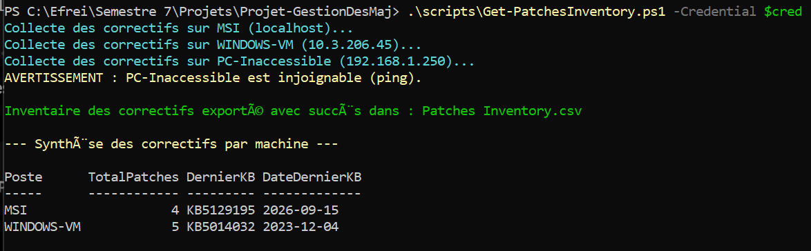
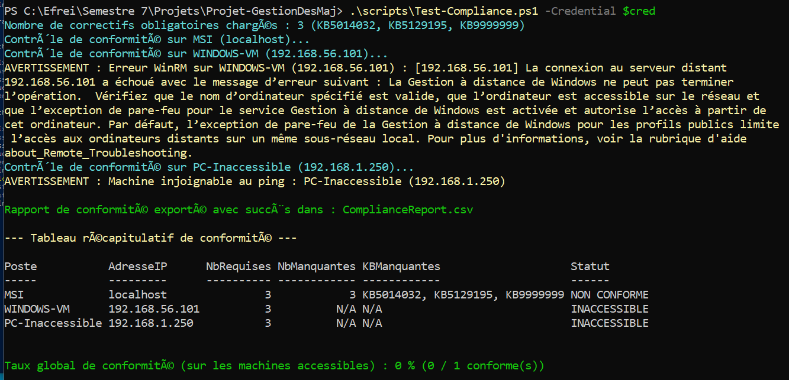
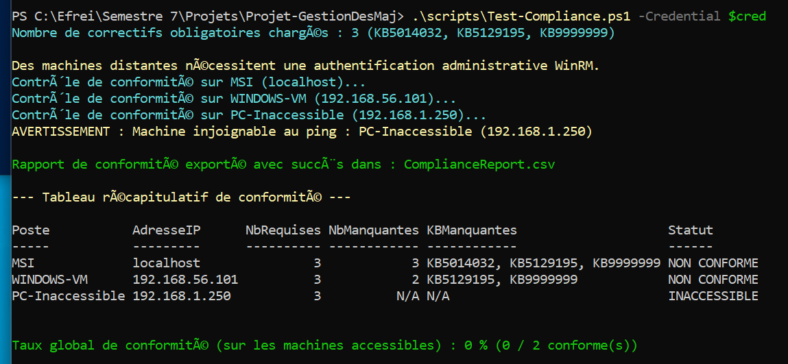

# Rapport de Projet : Système de Gestion des Mises à Jour en PowerShell

**Auteur :** Jérémy Lebourgeois  
**Formation :** EFREI Paris  
**Matière :** Sécurité des Systèmes  
**Dépôt GitHub :** [https://github.com/JeremyLebourgeois/Projet-GestionDesMaj](https://github.com/JeremyLebourgeois/Projet-GestionDesMaj)  

---

> **Dépôt de Code Source (GitHub) :**  
> L'ensemble des scripts PowerShell, fichiers de configuration (`computers.txt`, `required-patches.txt`), rapports d'audit CSV et captures d'écran de validation sont versionnés et disponibles sur le dépôt GitHub officiel du projet :  
> 👉 [https://github.com/JeremyLebourgeois/Projet-GestionDesMaj](https://github.com/JeremyLebourgeois/Projet-GestionDesMaj)

---

## 1. Architecture et Environnement de Test

Ce projet est réalisé par Jérémy Lebourgeois (EFREI Paris) et repose sur un environnement de test local permettant de simuler l'administration centralisée d'un parc de machines Windows.

### 1.1. Description du Réseau et des Machines

L'architecture du laboratoire de test est composée de deux entités principales complétées par une cible de test hors ligne :
- **Un poste hôte d'administration (`MSI`)** : Sous système d'exploitation Windows 11, il joue le rôle de point de contrôle central à partir duquel les scripts d'inventaire et de conformité sont exécutés.
- **Une machine virtuelle (VM) supervisée (`WINDOWS-VM`)** : Déployée sous Windows 10 via l'hyperviseur VirtualBox.
- **Une machine inaccessible (`PC-Inaccessible`)** : Hôte fictif simulant un équipement injoignable ou hors tension (`192.168.1.250`).

Ces machines sont reliées en réseau grâce à la configuration de l'interface réseau de la VM en mode **"Accès par pont" (Bridged)** ou **"Réseau privé hôte" (Host-Only)**, permettant d'appartenir au même sous-réseau logique et d'échanger des flux d'administration sans translation d'adresse.

### 1.2. Fichier d'Inventaire

Pour cibler les machines du parc lors des requêtes PowerShell, un fichier d'inventaire nommé `computers.txt` est utilisé. Ce fichier adopte un format simple et standardisé structuré autour de deux champs séparés par un point-virgule : `Nom;IP` (ex. : `WINDOWS-VM;192.168.56.101`).

### 1.3. Configuration WinRM et Tests de Connectivité

Afin de permettre l'exécution de commandes à distance depuis le poste hôte vers la machine virtuelle, le service de gestion à distance de Windows (WinRM) a été configuré selon la procédure suivante :

1. **Activation de PowerShell Remoting** : La commande `Enable-PSRemoting -Force` a été exécutée sur la machine cible pour démarrer le service WinRM et configurer l'écoute des requêtes distantes.
2. **Déblocage du Pare-Feu** : L'exception du pare-feu Windows pour WinRM nécessite que le profil réseau soit défini sur "Privé" ou "Domaine". En environnement de travail de type Workgroup, la commande `Set-NetConnectionProfile` a été utilisée pour passer le profil réseau en "Privé".
3. **Approbation des Hôtes** : L'environnement n'étant pas rattaché à un domaine Active Directory, il est indispensable d'autoriser l'hôte cible via la configuration de la liste de confiance WinRM sur le poste d'administration : `Set-Item WSMan:\localhost\Client\TrustedHosts -Value "*" -Force`.
4. **Validation du Service** : Le bon fonctionnement du service WinRM a été validé à l'aide de l'applet de commande `Test-WSMan`.

<p align="center">
  
</p>

**Tests d'interaction à distance effectués :**
- **Session interactive** : Ouverture d'un shell distant de manière interactive via `Enter-PSSession -ComputerName <IP> -Credential (Get-Credential)`.
- **Exécution non interactive** : Envoi de commandes via `Invoke-Command -ComputerName <IP> -ScriptBlock { <Commandes> } -Credential (Get-Credential)`.

<p align="center">
  
</p>

Dans les deux cas, le passage des identifiants s'est fait de manière explicite via `Get-Credential`.

### 1.4. Réponses aux Questions Théoriques (Partie 1)

#### 1. Quel est le rôle de WinRM dans PowerShell Remoting ?
WinRM (Windows Remote Management) est l'implémentation par Microsoft du protocole standard WS-Management. Il sert de moteur de transport sous-jacent pour PowerShell Remoting, permettant aux machines de communiquer entre elles, d'envoyer des objets sérialisés et d'exécuter des commandes à distance.

#### 2. Quelle commande permet d'activer PowerShell Remoting ?
La cmdlet `Enable-PSRemoting -Force` permet d'activer et de configurer automatiquement l'environnement pour accepter les commandes distantes, en démarrant le service WinRM et en créant les règles de pare-feu nécessaires.

#### 3. Quels ports réseau sont utilisés par WinRM ?
Par défaut, WinRM utilise le port TCP **5985 pour le trafic HTTP** et le port TCP **5986 pour le trafic HTTPS** (chiffrement TLS).

#### 4. Pourquoi le pare-feu Windows peut-il empêcher une connexion PowerShell distante ?
Le pare-feu Windows bloque par défaut le trafic entrant non sollicité. Même si WinRM est démarré, si les règles d'exception pour les ports 5985/5986 ne sont pas actives (notamment lorsque le profil réseau est "Public"), les tentatives de connexion PowerShell Remoting seront rejetées.

#### 5. Quelle différence existe-t-il entre tester la connectivité avec `Test-Connection` et tester WinRM avec `Test-WSMan` ?
- `Test-Connection` utilise le protocole ICMP (Ping) pour vérifier si la machine cible répond au niveau réseau.
- `Test-WSMan` interroge le service WinRM au niveau applicatif. Un succès confirme que la machine est joignable ET que le service d'administration à distance est configuré et à l'écoute.

#### 6. Pourquoi est-il préférable de vérifier l'accessibilité d'une machine avant de tenter une commande distante ?
Une vérification préalable évite les longs délais d'attente (timeouts) liés aux tentatives de connexion `Invoke-Command` sur des machines inactives ou injoignables. Cela améliore la fiabilité et la rapidité d'exécution des scripts de gestion de parc.

#### 7. Quels problèmes de sécurité peuvent apparaître si PowerShell Remoting est activé sans restriction ?
Une configuration sans restriction (comme `TrustedHosts = "*"` sans filtrage ou sur des réseaux publics) expose les systèmes à des attaques par force brute, à des mouvements latéraux d'attaquants, et potentiellement à de l'exécution de code à distance avec des privilèges élevés par des entités malveillantes non autorisées.

---

## 2. Inventaire du Parc (Partie 2)

L'objectif de cette partie est de collecter les informations matérielles et logicielles des machines du réseau de manière centralisée. Le script développé à cet effet est `scripts/Get-ParkInventory.ps1`.

### 2.1. Algorithme de Collecte et Robustesse

Le script met en œuvre plusieurs mécanismes pour assurer un inventaire fiable et optimisé :

1. **Lecture des cibles** : Le script parcourt le fichier `computers.txt` qui liste les machines à interroger (ex. : `MSI;localhost`, `WINDOWS-VM;192.168.56.101`, `PC-Inaccessible;192.168.1.250`).
2. **Gestion hybride de l'exécution** :
   - Pour le poste hôte (`localhost`), la collecte est effectuée en exécution directe locale. Cela permet de contourner les limitations strictes d'authentification réseau locales en mode Workgroup (erreur `0x8009030e`).
   - Pour les machines distantes, l'exécution s'appuie sur `Invoke-Command` en passant les identifiants requis via un objet credential.
3. **Robustesse et test de connectivité préalable** : Avant toute tentative de connexion WinRM, la disponibilité de chaque machine distante est validée via `Test-Connection` (ping ICMP). Cela permet d'identifier instantanément les hôtes injoignables (`PC-Inaccessible`) sans subir les longs délais d'attente (timeouts) liés à une requête WinRM dans le vide.

<p align="center">
  
</p>

4. **Collecte des métriques (WMI/CIM)** : L'inventaire extrait des données clés à l'aide de requêtes `Get-CimInstance` sur plusieurs classes :
   - `Win32_ComputerSystem` (Modèle, RAM totale)
   - `Win32_OperatingSystem` (Version de l'OS)
   - `Win32_BIOS` (Numéro de série)
   - `Win32_LogicalDisk` (Espace disque libre)
   - L'état du service Windows Update (`wuauserv`) est également relevé, ainsi que la dernière mise à jour installée via `Get-HotFix`.
5. **Exportation des résultats** : L'ensemble des données collectées est compilé dans un tableau d'objets personnalisés, puis exporté dans le fichier `ParkInventory.csv` avec un formatage robuste (délimiteur point-virgule et encodage UTF-8).

### 2.2. Résultats Obtenus

L'exécution du script sur l'environnement de test a permis d'obtenir l'inventaire suivant sans interruption, malgré la présence d'une machine injoignable.

| Nom de la Machine | Adresse IP | OS | RAM | Espace Libre (C:) | Statut |
| :--- | :--- | :--- | :--- | :--- | :--- |
| MSI | localhost | Windows 11 | 15,71 Go | 186,51 Go | Accessible |
| WINDOWS-VM | 192.168.56.101 | Windows 10 | 2,00 Go | 28,84 Go | Accessible |
| PC-Inaccessible | 192.168.1.250 | N/A | N/A | N/A | Inaccessible |

<p align="center">
  
</p>

<p align="center">
  
</p>

### 2.3. Réponses aux Questions Théoriques (Partie 2)

#### 1. Quelle est la différence entre WMI et CIM dans PowerShell ? Pourquoi CIM (`Get-CimInstance`) est-il recommandé aujourd'hui ?
WMI (Windows Management Instrumentation) est l'ancienne implémentation de Microsoft qui s'appuie sur les protocoles DCOM et RPC, souvent problématiques au travers des pare-feux. CIM (Common Information Model) est un standard de l'industrie ouvert. Les cmdlets CIM (`Get-CimInstance`) sont recommandées aujourd'hui car elles s'appuient sur le protocole standardisé WS-Management (via WinRM) qui est plus performant, orienté web (HTTP/HTTPS), nettement plus sécurisé et plus facile à configurer à travers les équipements réseau.

#### 2. Pourquoi `Invoke-Command` est-il plus adapté qu'une simple boucle de commandes distantes séquentielles pour administrer un parc ?
L'utilisation de `Invoke-Command` permet d'exécuter des scripts en parallèle sur de multiples machines distantes de façon native. En utilisant le paramètre `-ThrottleLimit`, la commande peut gérer l'exécution concurrente sur de multiples hôtes simultanément, ce qui réduit drastiquement le temps total d'exécution par rapport à une boucle classique itérant de manière séquentielle (une machine après l'autre).

#### 3. Pourquoi est-il critique de vérifier l'état du service Windows Update (`wuauserv`) lors d'un audit de parc ?
Le service Windows Update (`wuauserv`) est responsable de la recherche, du téléchargement et de l'installation des mises à jour. Si ce service est arrêté ou désactivé sur une machine, celle-ci ne pourra plus recevoir les correctifs de sécurité critiques (patchs automatiques ou déploiements centralisés via des outils de gestion). Vérifier son état est donc essentiel pour identifier immédiatement les hôtes vulnérables et isolés du cycle de mise à jour.

---

## 3. Inventaire des Correctifs (Partie 3)

Cette partie vise à recenser de manière exhaustive l'ensemble des mises à jour installées sur les machines du parc. Le script chargé de cette opération est `scripts/Get-PatchesInventory.ps1`.

### 3.1. Algorithme et Fonctionnement

Le script suit un processus structuré pour garantir une collecte efficace :

1. **Extraction des métriques** : Il s'appuie sur la cmdlet `Get-HotFix` pour récupérer les informations essentielles de chaque correctif, notamment `HotFixID` (le numéro KB), `Description`, `InstalledOn` (Date d'installation) et `InstalledBy` (Installé par).
2. **Exécution hybride et asynchrone** : De la même manière que pour l'inventaire matériel, le script interroge simultanément le poste hôte localement (pour éviter les erreurs d'authentification Workgroup) et la machine virtuelle (WINDOWS-VM) à distance via WinRM (avec `Invoke-Command`).
3. **Formatage et tri** : Les données brutes recueillies sont formatées (les dates sont converties au format `yyyy-MM-dd` ou marquées "Inconnue") puis triées par poste et par date d'installation décroissante.
4. **Exportation des données** : Les objets résultants sont exportés dans le fichier `Patches Inventory.csv`, en utilisant le point-virgule (`;`) comme délimiteur et l'encodage `UTF-8` pour assurer une compatibilité optimale.
5. **Génération d'un résumé en console** : À l'aide de la cmdlet `Group-Object`, le script génère une synthèse finale affichée dans la console. Ce tableau récapitule pour chaque machine le volume total de correctifs appliqués et les détails du tout dernier patch déployé.

### 3.2. Résultats Obtenus

L'exécution du script sur l'environnement de test a produit l'inventaire suivant :
- **MSI (Hôte local)** : 4 correctifs recensés. Le dernier patch appliqué est le **KB5129195**.
- **WINDOWS-VM (Machine virtuelle)** : 5 correctifs recensés. Le dernier patch appliqué est le **KB5014032**.
- **PC-Inaccessible** : Le poste a été filtré proprement grâce au ping préalable (ICMP), permettant au script de continuer sans blocage ni erreur de timeout WinRM.

<p align="center">
  
</p>

### 3.3. Réponses aux Questions Théoriques (Partie 3)

#### 1. Que représente un numéro KB chez Microsoft et quel est son cycle de publication (Patch Tuesday) ?
Un numéro KB (Knowledge Base) est un identifiant unique attribué par Microsoft à chaque mise à jour, correctif de sécurité ou article technique. Microsoft publie massivement ces mises à jour correctives de sécurité le deuxième mardi de chaque mois, un événement communément appelé le **"Patch Tuesday"**.

#### 2. Pourquoi `Get-HotFix` peut-il renvoyer un champ `InstalledOn` vide ou au format texte brut selon les types de correctifs ?
La cmdlet `Get-HotFix` s'appuie sur la classe WMI `Win32_QuickFixEngineering`. Selon la manière dont un correctif a été packagé et appliqué (par exemple, via Windows Update, un MSI, ou un installeur tiers), le fournisseur WMI sous-jacent peut ne pas parvenir à parser la date d'installation. Dans certains cas, la date n'est tout simplement pas enregistrée dans le système, ou elle est retournée sous forme de chaîne de caractères (String) plutôt que comme un objet DateTime, nécessitant un traitement conditionnel dans le script.

#### 3. Quelle est la différence entre une mise à jour de sécurité cumulative (LCU) et une mise à jour de pile de maintenance (SSU) ?
- **LCU (Latest Cumulative Update)** : C'est une mise à jour mensuelle qui regroupe tous les correctifs de sécurité et de qualité précédents. L'installation du dernier LCU garantit que le système est à jour au niveau fonctionnel et sécuritaire.
- **SSU (Servicing Stack Update)** : C'est une mise à jour du composant même qui installe les mises à jour Windows (la pile de maintenance). Les SSU doivent souvent être installées *avant* les LCU pour que le moteur de mise à jour soit capable de traiter correctement et de déployer les nouveaux packages de correctifs cumulatifs.

---

## 4. Contrôle de Conformité des Correctifs (Partie 4)

L'objectif de cette étape est de transformer un simple inventaire passif en un moteur de gouvernance et d'audit de sécurité actif. Il s'agit de confronter l'état réel des correctifs appliqués sur chaque machine du parc aux exigences minimales dictées par la politique de sécurité (baseline de patchs obligatoires). Le script développé à cette fin est `scripts/Test-Compliance.ps1`.

### 4.1. Architecture et Environnement de Test

Pour valider le fonctionnement de la solution dans des conditions représentatives et reproductibles, l'environnement de test a été stabilisé autour des composants suivants :

1. **Virtualisation sous VirtualBox et Réseau Privé Hôte (Host-Only)** :
   - Afin d'éviter les aléas liés aux baux DHCP changeants et aux filtrages Wi-Fi en mode "Accès par pont" (Bridged), la carte réseau de la machine virtuelle a été configurée sur un adaptateur **Réseau privé hôte (Host-Only)** (`192.168.56.0/24`).
   - Une adresse IP statique dédiée a été attribuée à la machine virtuelle : **`192.168.56.101`**. Cette configuration garantit un canal de communication isolé, déterministe et pérenne entre l'hôte d'administration (`MSI`) et la cible supervisée (`WINDOWS-VM`).

2. **Fichiers de Paramétrage et de Référence** :
   - **`computers.txt`** : Répertoire d'inventaire délimité par des points-virgules (`Nom;IP`). Il modélise la diversité du parc :
     ```text
     MSI;localhost
     WINDOWS-VM;192.168.56.101
     PC-Inaccessible;192.168.1.250
     ```
   - **`required-patches.txt`** : Référentiel de conformité édictant la liste des correctifs de sécurité jugés critiques et obligatoires :
     ```text
     KB5014032
     KB5129195
     KB9999999
     ```

### 4.2. Algorithme et Fonctionnement du Script `Test-Compliance.ps1`

Le script applique une séquence rigoureuse d'étapes garantissant la fiabilité des résultats et l'absence de blocages réseau :

1. **Chargement et Normalisation du Référentiel** :
   - Le fichier `required-patches.txt` est parsé en éliminant les lignes vides ou espaces superflus (`Where-Object { $_ -match '\S' }`), en convertissant tous les identifiants en majuscules (`ToUpper()`), et en supprimant les éventuels doublons (`Select-Object -Unique`).
2. **Collecte Hybride et Gestion de l'Accessibilité** :
   - **Cibles locales (`localhost`, `127.0.0.1`, nom de machine hôte)** : Exécution directe en mémoire de `Get-HotFix` avec extraction des propriétés `HotFixID`. Cela évite toute boucle réseau et contourne les restrictions d'authentification réseau locales en environnement Workgroup.
   - **Cibles distantes** : 
     - *Pré-filtrage ICMP* : Exécution d'un `Test-Connection -ComputerName $pc.IP -Count 1 -Quiet`. En cas d'échec (comme pour `PC-Inaccessible`), le poste est immédiatement qualifié `INACCESSIBLE` avec `KBManquantes = N/A`, épargnant à l'administrateur les 30 à 60 secondes de timeout inhérentes à une tentative WinRM dans le vide.
     - *Exécution distante* : Appel de `Invoke-Command` avec le scriptblock de collecte et passage d'un objet credential (`[pscredential]$Credential`).
     - *Résilience de collecte* : En cas d'anomalie d'exécution sur `Get-HotFix` au sein de la session distante, un mécanisme de repli (`try/catch`) bascule automatiquement sur l'interrogation de la classe CIM `Win32_QuickFixEngineering`.
3. **Moteur d'Évaluation de Conformité** :
   - L'ensemble des correctifs requis est comparé à la liste des correctifs installés via l'opérateur `-notin` :
     ```powershell
     $missing = @($requiredKBs | Where-Object { $_ -notin $installed })
     ```
   - Si `$missing.Count -eq 0`, le statut est **`CONFORME`** et la mention des KB manquantes indique **`Aucune`**.
   - Si `$missing.Count -gt 0`, le statut est **`NON CONFORME`** et les KB absentes sont énumérées explicitement (ex. `KB5129195, KB9999999`).
4. **Calcul du Taux Global de Conformité** :
   - Conformément aux bonnes pratiques d'audit, les postes classés `INACCESSIBLE` sont exclus du dénominateur pour ne pas fausser l'indicateur d'état des systèmes réellement audités :
     $$\text{Taux de conformité} = \left( \frac{\text{Nombre de postes CONFORMES}}{\text{Nombre de postes ACCESSIBLES}} \right) \times 100$$
5. **Exportation et Reporting** :
   - Les résultats structurés sont exportés au format standardisé dans `ComplianceReport.csv` (délimiteur point-virgule `;`, encodage `UTF-8`, sans métadonnées de type `#TYPE`).
   - Une restitution claire est projetée dans la console PowerShell sous forme de tableau formaté.

### 4.3. Résolution des Incidents et Configuration WinRM en Workgroup

L'administration à distance sous Windows dans un environnement sans contrôleur de domaine (Workgroup) impose de lever plusieurs verrous de sécurité sous-jacents qui génèrent des erreurs fréquentes :

1. **Erreur d'authentification `0x8009030e` (*« Une ouverture de session spécifiée n'existe pas »*)** :
   - *Cause* : Lorsqu'une connexion WinRM est initiée vers une adresse IP sans précision du protocole, PowerShell tente d'employer Kerberos par défaut. Kerberos ne pouvant pas résoudre de nom de principal de service (SPN) pour une simple adresse IP, l'authentification est rejetée. De plus, si l'administrateur saisit un nom d'utilisateur non qualifié (ex. `admin` au lieu de `WINDOWS-VM\admin`), le sous-système de sécurité local (LSA/SSPI) recherche le compte sur la machine cliente émettrice.
   - *Résolution technique* :
     - Forçage explicite du mode d'authentification NTLM/SPNEGO via le paramètre `-Authentication Negotiate` dans `Invoke-Command`.
     - Qualification dynamique des identifiants dans le script : si le nom d'utilisateur ne contient pas de délimiteur de domaine (`\`), le script le préfixe automatiquement avec le nom de la machine cible (`$pc.Nom\$userOnly`).

<p align="center">
  
</p>

2. **Filtrage UAC distant et clé `LocalAccountTokenFilterPolicy`** :
   - *Cause* : Par défaut, le Contrôle de Compte d'Utilisateur (UAC) de Windows filtre les jetons administratifs des comptes locaux lors d'un accès réseau distant. Même si le compte distant appartient au groupe `Administrateurs`, il ne dispose que de privilèges restreints, provoquant une erreur `Accès refusé` lors des appels WMI/HotFix.
   - *Résolution technique* : Sur la machine virtuelle distante (`WINDOWS-VM`), exécution de la commande de registre permettant de désactiver le filtrage du jeton distant pour les administrateurs locaux :
     ```powershell
     New-ItemProperty -Path "HKLM:\SOFTWARE\Microsoft\Windows\CurrentVersion\Policies\System" -Name "LocalAccountTokenFilterPolicy" -Value 1 -PropertyType DWORD -Force
     ```

3. **Classification du Profil Réseau (Privé vs Public)** :
   - *Cause* : Les cartes réseaux virtuelles (Host-Only) sont fréquemment assignées par défaut au profil "Public" par Windows 10. Les règles du pare-feu Windows associées à WinRM interdisent formellement les connexions entrantes sur les réseaux publics.
   - *Résolution technique* : Basculement de l'interface réseau en profil privé sur la machine cible :
     ```powershell
     Set-NetConnectionProfile -InterfaceAlias "Ethernet 2" -NetworkCategory Private
     ```

4. **Liste des Hôtes Approuvés (`TrustedHosts`)** :
   - *Cause* : En l'absence de certificats TLS (HTTPS) et de tickets Kerberos pour valider l'identité du serveur distant, le client WinRM refuse d'envoyer les identifiants d'authentification sur le port HTTP 5985.
   - *Résolution technique* : Enregistrement de l'adresse de la VM dans la liste de confiance du poste d'administration :
     ```powershell
     Set-Item WSMan:\localhost\Client\TrustedHosts -Value "192.168.56.101" -Force
     ```

### 4.4. Résultats Obtenus et Validation

Le script a été exécuté sur l'environnement complet avec le passage explicite des identifiants administratifs de la machine virtuelle :

```powershell
$sec = ConvertTo-SecureString "altousJL_356" -AsPlainText -Force
$cred = New-Object System.Management.Automation.PSCredential("admin", $sec)

.\scripts\Test-Compliance.ps1 -Credential $cred
```

#### Restitution Console

```text
Nombre de correctifs obligatoires chargés : 3 (KB5014032, KB5129195, KB9999999)
Contrôle de conformité sur MSI (localhost)...
Contrôle de conformité sur WINDOWS-VM (192.168.56.101)...
Contrôle de conformité sur PC-Inaccessible (192.168.1.250)...
AVERTISSEMENT : Machine injoignable au ping : PC-Inaccessible (192.168.1.250)

Rapport de conformité exporté avec succès dans : ComplianceReport.csv

--- Tableau récapitulatif de conformité ---

Poste           AdresseIP      NbRequises NbManquantes KBManquantes                    Statut      
-----           ---------      ---------- ------------ ------------                    ------      
MSI             localhost               3            3 KB5014032, KB5129195, KB9999999 NON CONFORME
WINDOWS-VM      192.168.56.101          3            2 KB5129195, KB9999999            NON CONFORME
PC-Inaccessible 192.168.1.250           3          N/A N/A                             INACCESSIBLE

Taux global de conformité (sur les machines accessibles) : 0 % (0 / 2 conforme(s))
```

<p align="center">
  
</p>

#### Analyse des Résultats :
- **MSI (Machine locale)** : Interrogée directement en local. 3 correctifs requis, aucun présent parmi la sélection de test $\rightarrow$ **NON CONFORME**.
- **WINDOWS-VM (192.168.56.101)** : Connectée avec succès via WinRM (Negotiate NTLM). Le patch de sécurité `KB5014032` est bien détecté sur la VM, tandis que les correctifs `KB5129195` et `KB9999999` sont absents $\rightarrow$ **NON CONFORME** avec 2 manquantes.
- **PC-Inaccessible (192.168.1.250)** : Traité immédiatement comme `INACCESSIBLE` via le test ping préalable, sans blocage du script.
- **Taux de conformité** : Évalué rigoureusement à **0 %** sur les 2 machines accessibles auditées.
- **Fichier `ComplianceReport.csv`** : Fichier tabulaire généré sans erreur avec séparateur `;` et encodage UTF-8, prêt pour l'intégration dans un tableau de bord ou un SIEM.

### 4.5. Réponses aux Questions Théoriques (Partie 4)

#### Pourquoi la politique de conformité doit-elle être régulièrement mise à jour ?
Une politique de conformité fixe une exigence minimale de sécurité à un instant $t$. Cependant, le paysage des cybermenaces est dynamique : de nouvelles vulnérabilités zero-day ou failles critiques (CVE) sont découvertes en permanence, et Microsoft publie de nouveaux correctifs cumulatifs chaque mois (notamment lors du Patch Tuesday). 
Si la liste des correctifs requis (`required-patches.txt`) n'est pas régulièrement actualisée, le système d'audit continuera de qualifier de « CONFORME » des machines qui disposent d'anciennes mises à jour, mais qui demeurent totalement vulnérables aux failles récentes. La politique de conformité doit donc suivre le cycle de vie des correctifs pour maintenir le niveau de sécurité réel du système d'information.

---

## 5. Notifications et Sécurisation

Cette section aborde les mécanismes d'alerte automatisés en cas de non-conformité (Partie 7) ainsi que les mesures de durcissement et d'atténuation des risques pour la sécurité globale de la solution de Patch Management (Partie 8).

### 5.1. Mécanisme d'Alerte et Notifications (Partie 7)

#### 1. Déclenchement Conditionnel et Formatage des Alertes
Le système d'alerte est conçu pour éliminer le bruit d'alerte (*alert fatigue*) :
- Le script analyse les résultats consolidés issus de `ComplianceReport.csv`.
- Une notification n'est expédiée **que si au moins une machine est dans l'état `NON CONFORME` ou `INACCESSIBLE`**. Si l'intégralité du parc est conforme, l'exécution s'achève silencieusement.
- Le message synthétique envoyé à l'administrateur récapitule la volumétrie et détaille les anomalies :
  ```text
  Objet : [PATCH MANAGEMENT] Anomalies détectées - 21/10/2026

  Postes contrôlés     : 3
  Postes non conformes : 2
  Postes inaccessibles : 1

  WINDOWS-VM : NON CONFORME
               KB5129195, KB9999999 manquante(s)

  MSI        : NON CONFORME
               KB5014032, KB5129195, KB9999999 manquante(s)

  PC-Inaccessible : INACCESSIBLE
  ```
- Le rapport `ComplianceReport.csv` est automatiquement joint au message, et l'événement est consigné dans le journal d'audit `PatchManager.log` (`21/10/2026 10:48:24 ; Notification envoyée à admin@entreprise.local`).

#### 2. Limites du Protocole SMTP Standard
L'utilisation de la cmdlet classique `Send-MailMessage` via un serveur SMTP présente plusieurs faiblesses critiques en cybersécurité :
- **Absence de chiffrement de bout en bout et authentification faible** : Le protocole SMTP simple (port 25 ou 587) souffre souvent de l'absence d'authentification multifacteur (MFA). L'utilisation de protocoles dépréciés comme TLS 1.0/1.1 expose les flux à des attaques de type Man-in-the-Middle (MitM).
- **Vulnérabilité au spoofing d'adresse (usurpation)** : Sans configuration stricte de SPF, DKIM et DMARC, les courriels peuvent être facilement forgés ou interceptés.
- **Stockage à risque des secrets** : Les scripts batch/PowerShell automatisés sont souvent tentés d'intégrer des mots de passe de boîte mail en dur dans le code, ce qui constitue une violation majeure des règles de sécurité.
- **Obsolescence de la cmdlet** : Microsoft a formellement déprécié la cmdlet `Send-MailMessage` dans PowerShell en raison de son incapacité à supporter les standards de sécurité modernes (OAuth 2.0).

#### 3. Alternatives Modernes en Environnement de Production
En entreprise, l'envoi direct par SMTP non authentifié doit être remplacé par :
- **API Graph Microsoft (Microsoft 365 / Entra ID)** : Authentification moderne via jeton OAuth 2.0 (Service Principal avec secret ou certificat applicatif) pour émettre des courriels sécurisés via l'API REST `https://graph.microsoft.com/v1.0/sendMail`.
- **Webhooks Entrants (Microsoft Teams / Slack)** : Notification instantanée des équipes SOC/CERT sur des canaux dédiés au format Adaptive Cards, sans dépendance vis-à-vis d'une boîte de messagerie.
- **Collecte SIEM et Event Forwarding (WEF / Syslog TLS)** : Export direct des événements vers un SIEM (Splunk, Microsoft Sentinel, Elastic Security) déclenchant des règles de détection et des playbooks SOAR (Security Orchestration, Automation and Response).

---

### 5.2. Sécurisation et Durcissement de la Solution (Partie 8)

#### 1. Analyse des Risques Liés à WinRM / PowerShell Remoting
L'ouverture de canaux d'administration distante introduit des vecteurs d'attaque potentiels :
- **Mouvements latéraux** : Un attaquant ayant compromis un compte administratif peut rebondir d'hôte en hôte via `Invoke-Command`.
- **Attaques par rejeu et force brute NTLM** : En environnement Workgroup sans Kerberos, les échanges d'authentification NTLM peuvent être ciblés par du Password Spraying ou des attaques par relais NTLM.
- **Exécution arbitraire de code** : L'accès interactif WinRM permet par défaut d'exécuter n'importe quel binaire ou script présent sur la cible.

#### 2. Cloisonnement Réseau et Règles Pare-Feu
- **Filtrage des adresses sources** : Les règles de pare-feu autorisant le port TCP 5985 doivent être restreintes par une liste blanche d'adresses IP (`RemoteAddress`) correspondant exclusivement aux postes des administrateurs ou au serveur d'orchestration (bastion), et strictement cantonnées aux profils de réseau Privé ou Domaine.
- **Chiffrement du transport** : En Workgroup, le passage sur le port HTTPS **5986** avec certificat TLS x509 dédié doit être privilégié pour garantir le chiffrement et l'authenticité mutuelle sans dépendre de `TrustedHosts`.

#### 3. Gestion des Identifiants et Principe de Moindre Privilège
- **Comptes dédiés de service** : Les comptes utilisés pour les scripts d'audit ne doivent jamais être des comptes d'administration générale (Domain Admins ou administrateurs locaux réutilisés).
- **Droit d'accès distant restreint** : L'utilisateur d'audit doit appartenir au groupe local **`Remote Management Users`** (autorisant la session WinRM) et posséder uniquement les droits de lecture sur les espaces de noms WMI (`Root\cimv2`), sans appartenir au groupe `Administrateurs`.

#### 4. Just Enough Administration (JEA)
Le framework **JEA (Just Enough Administration)** est une technologie PowerShell permettant de créer des points de terminaison distants sur mesure (*Session Configuration*) :
- **Principe** : L'administrateur se connecte sous un compte restreint, mais les commandes autorisées sont exécutées avec des privilèges élevés délégués par un compte virtuel (*Virtual Account*).
- **Application au Patch Management** : Au lieu d'offrir un shell PowerShell complet, la session distante est configurée via un fichier de capacités de rôle (`.psrc`) qui expose **strictement** les cmdlets nécessaires : `Get-HotFix`, `Get-CimInstance`, et `Get-Service`. Toutes les commandes potentiellement dangereuses (`Invoke-Expression`, accès aux disques, gestion des utilisateurs) sont purement bloquées.

#### 5. Conservation, Intégrité et Confidentialité des Journaux et Rapports
- **Contrôle d'accès NTFS strict** : Les répertoires de sortie contenant `ComplianceReport.csv` et `PatchManager.log` doivent n'être accessibles en écriture qu'au compte d'exécution du script, et en lecture seule aux auditeurs autorisés.
- **Horodatage et intégrité** : Calcul périodique d'une empreinte cryptographique (SHA-256) des rapports d'audit pour certifier la non-répudiation et détecter toute tentative de falsification après analyse.
- **Centralisation des journaux** : Les événements d'audit doivent être répliqués en temps réel vers un serveur de journalisation distant en mode WORM (Write Once, Read Many) afin d'empêcher un attaquant d'effacer ses traces en cas de compromission locale.