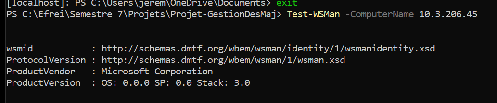
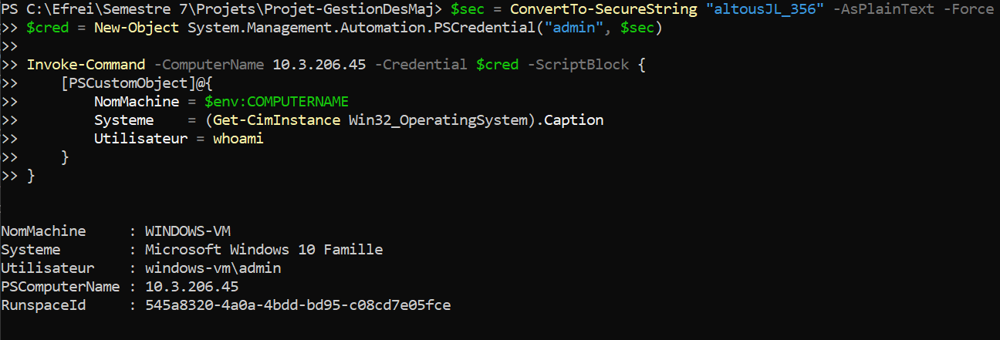
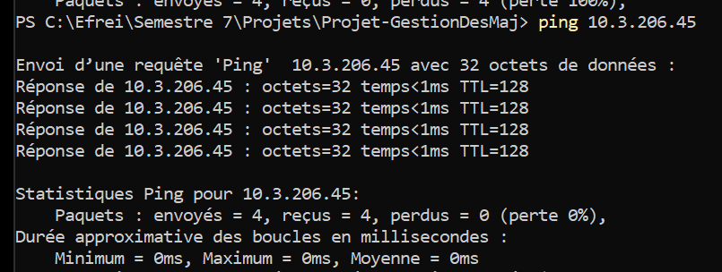
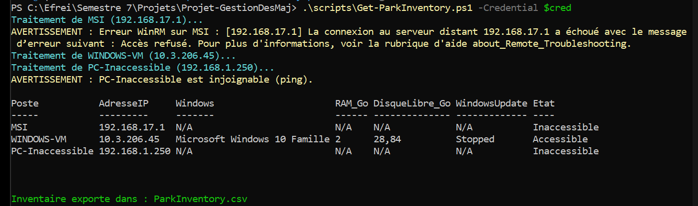
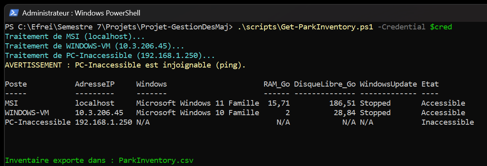

# Rapport de Projet : Système de Gestion des Mises à Jour en PowerShell

**Auteur :** Jérémy Lebourgeois  
**Formation :** EFREI Paris  
**Matière :** Sécurité des Systèmes  

---

## 1. Architecture et Environnement de Test

Ce projet est réalisé par Jérémy Lebourgeois (EFREI Paris) et repose sur un environnement de test local permettant de simuler l'administration centralisée d'un parc de machines Windows.

### 1.1. Description du Réseau et des Machines

L'architecture du laboratoire de test est composée de deux entités :
- **Un poste hôte d'administration** : Sous système d'exploitation Windows, il joue le rôle de point de contrôle central à partir duquel les scripts d'inventaire et de conformité sont exécutés.
- **Une machine virtuelle (VM) supervisée** : Déployée sous Windows 10 via l'hyperviseur VirtualBox.

Ces deux machines sont reliées en réseau grâce à la configuration de l'interface réseau de la VM en mode **"Accès par pont" (Bridged)**, ce qui leur permet d'appartenir au même sous-réseau logique et de communiquer directement.

### 1.2. Fichier d'Inventaire

Pour cibler les machines du parc lors des requêtes PowerShell, un fichier d'inventaire nommé `computers.txt` est utilisé. Ce fichier adopte un format simple et standardisé structuré autour de deux champs séparés par un point-virgule : `Nom;IP` (ex. : `VM-Client01;192.168.1.50`).

### 1.3. Configuration WinRM et Tests de Connectivité

Afin de permettre l'exécution de commandes à distance depuis le poste hôte vers la machine virtuelle, le service de gestion à distance de Windows (WinRM) a été configuré selon la procédure suivante :

1. **Activation de PowerShell Remoting** : La commande `Enable-PSRemoting -Force` a été exécutée sur la machine cible pour démarrer le service WinRM et configurer l'écoute des requêtes distantes.
2. **Déblocage du Pare-Feu** : L'exception du pare-feu Windows pour WinRM nécessite que le profil réseau soit défini sur "Privé" ou "Domaine". En environnement de travail de type Workgroup, la commande `Set-NetConnectionProfile` a été utilisée pour passer le profil réseau en "Privé".
3. **Approbation des Hôtes** : L'environnement n'étant pas rattaché à un domaine Active Directory, il est indispensable d'autoriser l'hôte cible via la configuration de la liste de confiance WinRM sur le poste d'administration : `Set-Item WSMan:\localhost\Client\TrustedHosts -Value "*" -Force`.
4. **Validation du Service** : Le bon fonctionnement du service WinRM a été validé à l'aide de l'applet de commande `Test-WSMan`.

**Tests d'interaction à distance effectués :**
- **Session interactive** : Ouverture d'un shell distant de manière interactive via `Enter-PSSession -ComputerName <IP> -Credential (Get-Credential)`.
- **Exécution non interactive** : Envoi de commandes via `Invoke-Command -ComputerName <IP> -ScriptBlock { <Commandes> } -Credential (Get-Credential)`.

Dans les deux cas, le passage des identifiants s'est fait de manière explicite via `Get-Credential`.

### 1.4. Réponses aux Questions Théoriques (Partie 1)

#### 1. Quel est le rôle de WinRM dans PowerShell Remoting ?
WinRM (Windows Remote Management) est l'implémentation par Microsoft du protocole standard WS-Management. Il sert de moteur de transport sous-jacent pour PowerShell Remoting, permettant aux machines de communiquer entre elles, d'envoyer des objets sérialisés et d'exécuter des commandes à distance.

#### 2. Quelle commande permet d'activer PowerShell Remoting ?
La cmdlet `Enable-PSRemoting -Force` permet d'activer et de configurer automatiquement l'environnement pour accepter les commandes distantes, en démarrant le service WinRM et en créant les règles de pare-feu nécessaires.

#### 3. Quels ports réseau sont utilisés par WinRM ?
Par défaut, WinRM utilise le port TCP **5985 pour le trafic HTTP** et le port TCP **5986 pour le trafic HTTPS** (chiffrement TLS).

#### 4. Pourquoi le pare-feu Windows peut-il empêcher une connexion PowerShell distante ?
Le pare-feu Windows bloque par défaut le trafic entrant non sollicité. Même si WinRM est démarré, si les règles d'exception pour les ports 5985/5986 ne sont pas actives (notamment lorsque le profil réseau est "Public"), les tentatives de connexion PowerShell Remoting seront rejetées.

#### 5. Quelle différence existe-t-il entre tester la connectivité avec `Test-Connection` et tester WinRM avec `Test-WSMan` ?
- `Test-Connection` utilise le protocole ICMP (Ping) pour vérifier si la machine cible répond au niveau réseau.
- `Test-WSMan` interroge le service WinRM au niveau applicatif. Un succès confirme que la machine est joignable ET que le service d'administration à distance est configuré et à l'écoute.

#### 6. Pourquoi est-il préférable de vérifier l'accessibilité d'une machine avant de tenter une commande distante ?
Une vérification préalable évite les longs délais d'attente (timeouts) liés aux tentatives de connexion `Invoke-Command` sur des machines inactives ou injoignables. Cela améliore la fiabilité et la rapidité d'exécution des scripts de gestion de parc.

#### 7. Quels problèmes de sécurité peuvent apparaître si PowerShell Remoting est activé sans restriction ?
Une configuration sans restriction (comme `TrustedHosts = "*"` sans filtrage ou sur des réseaux publics) expose les systèmes à des attaques par force brute, à des mouvements latéraux d'attaquants, et potentiellement à de l'exécution de code à distance avec des privilèges élevés par des entités malveillantes non autorisées.

## 2. Inventaire du Parc (Partie 2)

L'objectif de cette partie est de collecter les informations matérielles et logicielles des machines du réseau de manière centralisée. Le script développé à cet effet est `scripts/Get-ParkInventory.ps1`.

### 2.1. Algorithme de Collecte et Robustesse

Le script met en œuvre plusieurs mécanismes pour assurer un inventaire fiable et optimisé :

1. **Lecture des cibles** : Le script parcourt le fichier `computers.txt` qui liste les machines à interroger (ex. : `MSI;localhost`, `WINDOWS-VM;10.3.206.45`, `PC-Inaccessible;192.168.1.250`).
2. **Gestion hybride de l'exécution** :
   - Pour le poste hôte (`localhost`), la collecte est effectuée en exécution directe locale. Cela permet de contourner les limitations strictes d'authentification réseau locales en mode Workgroup (erreur `0x8009030e`).
   - Pour les machines distantes, l'exécution s'appuie sur `Invoke-Command` en passant les identifiants requis via un objet credential.
3. **Robustesse et test de connectivité préalable** : Avant toute tentative de connexion WinRM, la disponibilité de chaque machine distante est validée via `Test-Connection` (ping ICMP). Cela permet d'identifier instantanément les hôtes injoignables (`PC-Inaccessible`) sans subir les longs délais d'attente (timeouts) liés à une requête WinRM dans le vide.

   
4. **Collecte des métriques (WMI/CIM)** : L'inventaire extrait des données clés à l'aide de requêtes `Get-CimInstance` sur plusieurs classes :
   - `Win32_ComputerSystem` (Modèle, RAM totale)
   - `Win32_OperatingSystem` (Version de l'OS)
   - `Win32_BIOS` (Numéro de série)
   - `Win32_LogicalDisk` (Espace disque libre)
   - L'état du service Windows Update (`wuauserv`) est également relevé, ainsi que la dernière mise à jour installée via `Get-HotFix`.
5. **Exportation des résultats** : L'ensemble des données collectées est compilé dans un tableau d'objets personnalisés, puis exporté dans le fichier `ParkInventory.csv` avec un formatage robuste (délimiteur point-virgule et encodage UTF-8).

### 2.2. Résultats Obtenus

L'exécution du script sur l'environnement de test a permis d'obtenir l'inventaire suivant sans interruption, malgré la présence d'une machine injoignable.

| Nom de la Machine | Adresse IP | OS | RAM | Espace Libre (C:) | Statut |
| :--- | :--- | :--- | :--- | :--- | :--- |
| MSI | localhost | Windows 11 | 15,71 Go | 186,51 Go | Accessible |
| WINDOWS-VM | 10.3.206.45 | Windows 10 | 2,00 Go | 28,84 Go | Accessible |
| PC-Inaccessible | 192.168.1.250 | N/A | N/A | N/A | Inaccessible |

### 2.3. Réponses aux Questions Théoriques (Partie 2)

#### 1. Quelle est la différence entre WMI et CIM dans PowerShell ? Pourquoi CIM (`Get-CimInstance`) est-il recommandé aujourd'hui ?
WMI (Windows Management Instrumentation) est l'ancienne implémentation de Microsoft qui s'appuie sur les protocoles DCOM et RPC, souvent problématiques au travers des pare-feux. CIM (Common Information Model) est un standard de l'industrie ouvert. Les cmdlets CIM (`Get-CimInstance`) sont recommandées aujourd'hui car elles s'appuient sur le protocole standardisé WS-Management (via WinRM) qui est plus performant, orienté web (HTTP/HTTPS), nettement plus sécurisé et plus facile à configurer à travers les équipements réseau.

#### 2. Pourquoi `Invoke-Command` est-il plus adapté qu'une simple boucle de commandes distantes séquentielles pour administrer un parc ?
L'utilisation de `Invoke-Command` permet d'exécuter des scripts en parallèle sur de multiples machines distantes de façon native. En utilisant le paramètre `-ThrottleLimit`, la commande peut gérer l'exécution concurrente sur de multiples hôtes simultanément, ce qui réduit drastiquement le temps total d'exécution par rapport à une boucle classique itérant de manière séquentielle (une machine après l'autre).

#### 3. Pourquoi est-il critique de vérifier l'état du service Windows Update (`wuauserv`) lors d'un audit de parc ?
Le service Windows Update (`wuauserv`) est responsable de la recherche, du téléchargement et de l'installation des mises à jour. Si ce service est arrêté ou désactivé sur une machine, celle-ci ne pourra plus recevoir les correctifs de sécurité critiques (patchs automatiques ou déploiements centralisés via des outils de gestion). Vérifier son état est donc essentiel pour identifier immédiatement les hôtes vulnérables et isolés du cycle de mise à jour.

### 2.4. Inventaire des Correctifs (Partie 3)
* Méthode de collecte des KB avec `Get-HotFix` (Partie 3)[cite: 4]
* Gestion des erreurs et des machines inaccessibles[cite: 3, 4]

## 3. Contrôle de Conformité et Reporting
* Algorithme de comparaison avec `required-patches.txt` (Partie 4)[cite: 4]
* Calcul du taux global de conformité[cite: 4]
* Génération du rapport HTML et système de logs (Partie 6)[cite: 5]

## 4. Notifications et Sécurisation
* Mécanisme d'alerte en cas d'anomalie et limites du SMTP (Partie 7)[cite: 5, 6]
* Durcissement de la solution : moindre privilège, pare-feu, JEA et intégrité des journaux (Partie 8)[cite: 6]